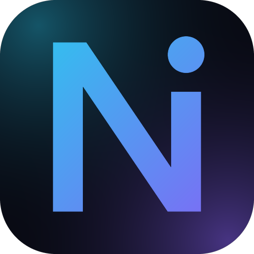

<p align="center">
  
</p>

<h1 align="center">NexVora AI Workspace</h1>
<p align="center"><b>Your Intelligent Digital Workspace</b></p>

<p align="center">
  Android AI workspace: chat with on-device (GGUF / llama.cpp) or cloud models, organise work in workspaces,
  and ask questions about your own documents (RAG).
</p>

---

## Status

**Phase 1 (done):** branding, package rename, Firebase removal.
**Phase 2:** redesigned dashboard and navigation, plus new Workspaces, Documents, AI Agents, Model Manager,
Search, Chat History, Profile and About screens, and a privacy review. See [PHASE2_REPORT.md](./PHASE2_REPORT.md),
[UI_SCREEN_MAP.md](./UI_SCREEN_MAP.md) and [KNOWN_LIMITATIONS.md](./KNOWN_LIMITATIONS.md).
**Phase 4 (this version):** hardening and audit — ChatGPT sign-in hidden, IP-location removed, keychain data-loss guard, document/model fixes, GitHub Actions build workflows, executable check scripts. See [PHASE4_REPORT.md](./PHASE4_REPORT.md), [FINAL_TEST_REPORT.md](./FINAL_TEST_REPORT.md), [INSTALLATION.md](./INSTALLATION.md), [CHANGELOG.md](./CHANGELOG.md).

**Phase 3:** production-readiness pass — Bengali (`bn`) locale fully translated, History export, document cleanup, offline/skeleton states, hardened backup rules, and the security/release documentation. See [PHASE3_REPORT.md](./PHASE3_REPORT.md), [FINAL_TEST_REPORT.md](./FINAL_TEST_REPORT.md), [SECURITY_REVIEW.md](./SECURITY_REVIEW.md), [BUILD_INSTRUCTIONS.md](./BUILD_INSTRUCTIONS.md), [RELEASE_CHECKLIST.md](./RELEASE_CHECKLIST.md).

**Nothing has been compiled or run on a device yet** (the authoring environment had no Android toolchain). No APK is included — build one with the GitHub Actions workflows in [BUILD_INSTRUCTIONS.md](./BUILD_INSTRUCTIONS.md) and test with `RELEASE_CHECKLIST.md`.

| Item | Value |
| --- | --- |
| App name | NexVora AI Workspace |
| Application id / namespace | `com.nexvora.aiworkspace` |
| Version | 1.0.0 (versionCode 1) |
| Developer | Prince AR Abdur Rahman |
| Publisher | NexVora Lab's Ofc |
| License | GPL-3.0-or-later (see [LICENSE](./LICENSE) and [NOTICE.md](./NOTICE.md)) |

## Navigation

Bottom bar: **Home · Workspaces · Documents · Models · Search**. The menu button on every screen opens the drawer with
AI Chat, AI Agents, Scheduled Tasks, Chat History, Settings, Profile, About NexVora, and your workspaces with their chats.

## What the app can do (existing engine, unchanged)

- On-device chat with GGUF models through llama.rn (CPU only) and Hugging Face model import
- Cloud / self-hosted providers: OpenAI, Anthropic, Google Gemini, OpenRouter, Ollama, LM Studio,
  OpenAI-compatible endpoints and more (see `src/utils/AiProviders`)
- Workspaces and chat threads (WatermelonDB), document import and RAG (ObjectBox vector DB)
- Document formats handled by the existing parsers: PDF, DOCX, PPTX, spreadsheets, text/CSV
- Tools (web search, web scraping, calendar, reminders, file creation, ...), scheduled jobs, share-sheet import,
  "Ask with NexVora AI Workspace" text-selection action, optional digital-assistant overlay

## Privacy

- No analytics and no crash-reporting SDK (Firebase was removed). NexVora has no servers of its own.
- Provider API keys are kept in the Android keystore-backed keychain (`react-native-keychain`), not in app storage; older plain-text keys are migrated on first start. Android auto-backup is disabled.
- **Web search is off** until you choose your own provider (Settings > Web search). There is no location lookup.
- The Profile screen lists every external service the app can contact and whether it is currently in use.

## Languages

English and Bengali (বাংলা) are fully translated. The other 16 languages are complete for the original app but the new NexVora screens still show English text there.

## Build

See [DEVELOPMENT.md](./DEVELOPMENT.md) and `STEP1_REPORT.md` for exact commands (Android Studio and Termux).

Quick version (PC with Node 20.19.5 per `.nvmrc`, JDK 17+, Android SDK 36, NDK 27.1.12297006):

```bash
yarn install
cp .env.example .env
yarn start            # terminal 1
yarn android          # terminal 2 (device / emulator connected)
# or build a debug APK:
cd android && ./gradlew assembleDebug
```

## Credits

Developed by Prince AR Abdur Rahman. Published by NexVora Lab's Ofc.
© 2026 NexVora Lab's Ofc. Licensed under GPL-3.0-or-later; based on
[AnythingLLM Mobile](https://github.com/Mintplex-Labs/anythingllm-mobile) by Mintplex Labs — see [NOTICE.md](./NOTICE.md).
